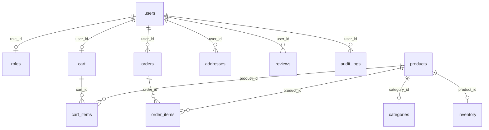

# Database Documentation

This document explains the MySQL/MariaDB database structure used by DMART CyberLab.

## Entity Relationship Summary
The database is structured in third normal form (3NF) to maintain transactional integrity. 

## Table Specifications

### 1. `roles`
Stores access levels for authorization.
* `id` (INT, Primary Key)
* `name` (VARCHAR, 'admin' or 'customer')

### 2. `users`
Stores user identities and profile details.
* `id` (INT, Primary Key)
* `username` (VARCHAR, Unique)
* `password_hash` (VARCHAR, Secure BCrypt hash)
* `role_id` (INT, Foreign Key referencing `roles.id`)
* `pincode` (VARCHAR, 6 digits)
* `avatar` (VARCHAR, avatar filename)
* `created_at` (TIMESTAMP)

### 3. `categories`
Stores product categories.
* `id` (INT, Primary Key)
* `name` (VARCHAR, Unique display name)
* `slug` (VARCHAR, URL friendly slug)

### 4. `products`
Stores product listings.
* `id` (INT, Primary Key)
* `name` (VARCHAR)
* `description` (TEXT)
* `category_id` (INT, Foreign Key referencing `categories.id`)
* `mrp` (DECIMAL, Manufacturer Recommended Price)
* `dmart_price` (DECIMAL, Discounted price)
* `image` (VARCHAR)

### 5. `inventory`
Tracks real-time stock levels.
* `product_id` (INT, Primary Key, Foreign Key referencing `products.id`)
* `stock` (INT, Quantity left in stock)
* `last_updated` (TIMESTAMP)

### 6. `cart`
Links active shopping baskets to logged-in customers.
* `id` (INT, Primary Key)
* `user_id` (INT, Unique, Foreign Key referencing `users.id`)
* `created_at` (TIMESTAMP)

### 7. `cart_items`
Lists individual items stored inside customer carts.
* `id` (INT, Primary Key)
* `cart_id` (INT, Foreign Key referencing `cart.id`)
* `product_id` (INT, Foreign Key referencing `products.id`)
* `quantity` (INT)

### 8. `coupons`
Defines promo discount codes.
* `id` (INT, Primary Key)
* `code` (VARCHAR, Unique uppercase string)
* `discount_percent` (INT)
* `min_spend` (DECIMAL)
* `is_active` (TINYINT)

### 9. `orders`
Stores transaction records.
* `id` (INT, Primary Key)
* `order_no` (VARCHAR, Unique order identifier)
* `user_id` (INT, Foreign Key referencing `users.id`)
* `total_amount` (DECIMAL)
* `coupon_applied` (VARCHAR)
* `status` (VARCHAR, 'Pending', 'Shipped', 'Delivered', 'Cancelled')
* `created_at` (TIMESTAMP)

### 10. `order_items`
Lists individual product lines bought in an order.
* `id` (INT, Primary Key)
* `order_id` (INT, Foreign Key referencing `orders.id`)
* `product_id` (INT, Foreign Key referencing `products.id`)
* `quantity` (INT)
* `price` (DECIMAL)

### 11. `addresses`
Stores user shipping destination options.
* `id` (INT, Primary Key)
* `user_id` (INT, Foreign Key referencing `users.id`)
* `address_line` (TEXT)
* `city` (VARCHAR)
* `state` (VARCHAR)
* `pincode` (VARCHAR, 6 digits)
* `is_default` (TINYINT)

### 12. `reviews`
Stores product customer review listings.
* `id` (INT, Primary Key)
* `product_id` (INT, Foreign Key referencing `products.id`)
* `user_id` (INT, Foreign Key referencing `users.id`)
* `rating` (INT, checked 1 to 5)
* `comment` (TEXT)

### 13. `audit_logs`
Logs critical application events.
* `id` (INT, Primary Key)
* `user_id` (INT, NULL allowed, Foreign Key referencing `users.id`)
* `event_type` (VARCHAR)
* `message` (TEXT)
* `timestamp` (TIMESTAMP)
